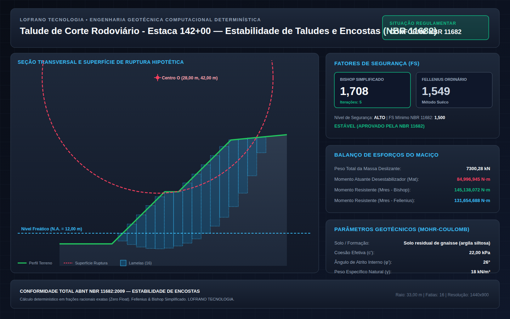

# Cálculo Determinístico de Estabilidade de Taludes e Encostas (ABNT NBR 11682:2009)

[](https://github.com/martinlofranodeoliveira/calculo-estabilidade-taludes-nbr11682/actions)
[](https://www.python.org/downloads/)
[](LICENSE)
[](#garantias-de-engenharia-e-auditoria)
[](#conformidade-normativa-abnt-nbr-116822009)

Motor computacional em Python puro (sem dependências externas) para análise de estabilidade de encostas e taludes de corte/aterro segundo os métodos de equilíbrio limite de **Fellenius (Ordinário)** e **Bishop Simplificado**, em estrita conformidade com a norma brasileira **ABNT NBR 11682:2009**.

Desenvolvido segundo o padrão de engenharia **LOFRANO TECNOLOGIA**, com **zero uso de ponto flutuante IEEE-754**, executando 100% dos cálculos físicos, geométricos e trigonométricos por meio de inteiros e frações racionais exatas (`fractions.Fraction`).

---



---

## Características Principais

1. **Aritmética Racional Exata (Zero Float)**:
   - Todas as grandezas físicas (coordenadas, larguras de fatia, pesos, poropressões e forças tangenciais/resistentes) são modeladas em unidades inteiras (milímetros, Newtons, Pascals).
   - Elimina integralmente distorções de truncamento e instabilidades numéricas acumuladas em iterações de convergência.
2. **Métodos Geotécnicos de Equilíbrio Limite**:
   - **Fellenius (1936)**: Método Sueco clássico para avaliação expedita e conservadora.
   - **Bishop Simplificado (1955)**: Consideração do equilíbrio de momentos com inclusão das forças normais entre lamelas adjacentes, resolvido por processo iterativo com critério de convergência de alta tolerância ($< 10^{-4}$).
3. **Envoltória de Resistência de Mohr-Coulomb**:
   - Equação constitutiva $s = c' + \sigma' \tan(\phi')$, contemplando a coesão efetiva $c'$, ângulo de atrito interno $\phi'$ e o alívio de tensões por poropressão de água subterrânea ($u = \gamma_w \cdot h_w$).
4. **Exportação Técnica Completa e Determinística**:
   - Laudo geotécnico analítico em Markdown formal.
   - Planilhas CSV protegidas contra injeção de fórmulas (`=`, `+`, `-`, `@`).
   - Painel visual em SVG 1440x900 com o traçado do perfil, superfície circular de ruptura e fatias discretizadas.
   - Empacotador ZIP determinístico (`os.O_EXCL`, timestamp fixado em `2026-01-01 00:00:00`).
5. **Auditor Independente em SQLite**:
   - Script de conferência cruzada `tools/verify_independent.py` que não importa o pacote da aplicação, carregando os dados brutos e reexecutando a análise através do banco em memória SQLite.

---

## Conformidade Normativa (ABNT NBR 11682:2009)

A Tabela 1 da **ABNT NBR 11682:2009** estipula os seguintes Fatores de Segurança mínimos admissíveis:

| Nível de Segurança | Descrição do Risco Operacional / Humano | FS Mínimo ($FS_{\min}$) | Racional Exato |
|:---|:---|:---:|:---:|
| **ALTO** | Alto risco de perdas de vidas humanas ou danos patrimoniais e ambientais graves | **1,50** | `3/2` |
| **MEDIO** | Médio risco, ocupação humana esporádica ou danos materiais moderados | **1,40** | `7/5` |
| **BAIXO** | Baixo risco, áreas desabitadas, taludes provisórios sem estruturas | **1,30** | `13/10` |

---

## Formulação Matemática Geotécnica

### 1. Discretização em Lamelas Verticais
O maciço deslizante definido pela interseção entre a superfície topográfica $y_{\text{topo}}(x)$ e o círculo de ruptura cilíndrico de centro $(X_c, Y_c)$ e raio $R$ é dividido em $n$ fatias verticais de largura $b_i$. Para cada lamela $i$:

- **Cota da base circular**: $y_{\text{base}, i} = Y_c - \sqrt{R^2 - (x_i - X_c)^2}$
- **Inclinação da base ($\alpha_i$)**: $\sin(\alpha_i) = \frac{x_i - X_c}{R}$
- **Peso da fatia**: $W_i = \gamma \cdot b_i \cdot (y_{\text{topo}, i} - y_{\text{base}, i})$
- **Poropressão na base**: $u_i = \gamma_w \cdot \max(0, y_{\text{NA}} - y_{\text{base}, i})$

### 2. Método Ordinário de Fellenius
$$FS_{\text{Fel}} = \frac{\sum_{i=1}^n \left[ c' \cdot l_i + (W_i \cos \alpha_i - u_i \cdot l_i) \tan \phi' \right]}{\sum_{i=1}^n W_i \sin \alpha_i}$$
Onde $l_i = \frac{b_i}{\cos \alpha_i}$ representa o comprimento do arco da base da lamela.

### 3. Método de Bishop Simplificado
$$FS_{\text{Bish}}^{(k+1)} = \frac{1}{\sum W_i \sin \alpha_i} \sum_{i=1}^n \frac{c' b_i + (W_i - u_i b_i) \tan \phi'}{m_{\alpha_i}(FS^{(k)})}$$
Com o coeficiente adimensional de inclinação:
$$m_{\alpha_i}(FS) = \cos \alpha_i \left( 1 + \frac{\tan \alpha_i \cdot \tan \phi'}{FS} \right)$$

---

## Instalação

Como o projeto utiliza exclusivamente a biblioteca padrão do Python:

```bash
# Clone o repositório
git clone https://github.com/martinlofranodeoliveira/calculo-estabilidade-taludes-nbr11682.git
cd calculo-estabilidade-taludes-nbr11682

# Instalação em modo de desenvolvimento (opcional)
pip install -e .
```

---

## Como Usar

### 1. Linha de Comando (CLI)

```bash
# Exibir versão do software
python3 -m estabilidade_taludes versao

# Consultar tabelas regulamentares e solos de referência da NBR 11682
python3 -m estabilidade_taludes tabelas

# Gerar arquivo de exemplo de talude rodoviário
python3 -m estabilidade_taludes exemplo --saida talude.json

# Calcular estabilidade com geração de todos os laudos e pacote ZIP
python3 -m estabilidade_taludes calcular talude.json \
    --saida-json resultado.json \
    --saida-csv-resumo resumo.csv \
    --saida-csv-fatias fatias.csv \
    --saida-md laudo.md \
    --saida-svg painel.svg \
    --zip laudo_completo.zip
```

### 2. Formato do Arquivo de Entrada (JSON Canônico)

```json
{
  "nome_talude": "Talude de Corte Rodoviário - Estaca 142+00",
  "descricao": "Corte em encosta natural de solo residual com berma intermediária e lençol freático rebaixado.",
  "nivel_seguranca_nbr11682": "ALTO",
  "perfil_terreno": [
    {"x_mm": 0, "y_mm": 10000},
    {"x_mm": 15000, "y_mm": 10000},
    {"x_mm": 30000, "y_mm": 20000},
    {"x_mm": 34000, "y_mm": 20000},
    {"x_mm": 49000, "y_mm": 30000},
    {"x_mm": 65000, "y_mm": 31000}
  ],
  "circulo_tentativa": {
    "centro_x_mm": 28000,
    "centro_y_mm": 42000,
    "raio_mm": 33000
  },
  "solo": {
    "nome_camada": "Solo residual de gnaisse (argila siltosa)",
    "peso_especifico_n_m3": 18500,
    "coesao_efetiva_pa": 22000,
    "angulo_atrito_graus": 26
  },
  "numero_fatias": 16,
  "nivel_dagua_y_mm": 12000,
  "sobrecarga_crista_pa": 0
}
```

---

## Verificação e Testes

O repositório inclui suite com mais de 50 testes unitários automatizados cobrindo geometria, trigonometria, física geotécnica, convergência, codecs e CLI:

```bash
# Execução da suite de testes
PYTHONPATH=src python3 -m unittest discover -s tests -v

# Execução do verificador independente (SQLite)
python3 tools/verify_independent.py

# Verificação de empacotamento fora da árvore de código
python3 scripts/check_distribution.py
```

---

## Garantias de Engenharia e Auditoria

- **Zero Dependências de Terceiros**: Não requer pacotes externos em tempo de execução.
- **Prevenção contra Injeção de Fórmulas**: Escrita em CSV prefixa campos com apóstrofo caso contenham `=`, `+`, `-`, `@`.
- **Prevenção de Sobrescrita Acidental**: Gravação de arquivos ZIP utiliza `os.O_EXCL` garantindo atomicidade.
- **Determinismo**: Todos os arquivos gerados possuem datas fixadas e hashes reproduzíveis.

---

## Licença

Distribuído sob a licença **MIT**. Consulte o arquivo [LICENSE](LICENSE) para mais detalhes.

---
**LOFRANO TECNOLOGIA** — Excelência em Engenharia Computacional Determinística e Aberta.
